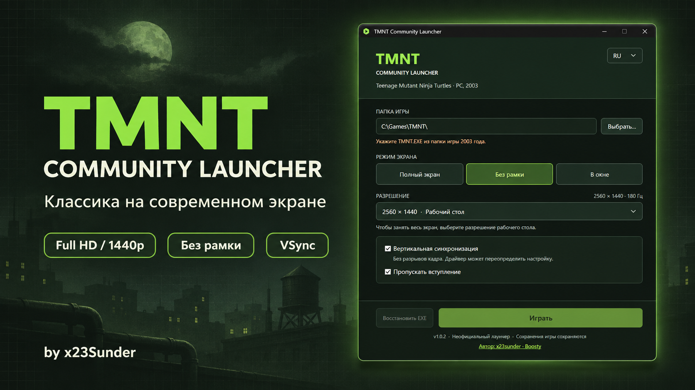

# TMNT 2003 Community Launcher

A portable launcher for **Teenage Mutant Ninja Turtles (PC, 2003)** with modern display settings.

**By [x23sunder · Retro Co-op](https://boosty.to/x23sunder/)** · [Русский](README.md)

**[Download v1.0.3](https://github.com/hallejuah/tmnt-2003-launcher-releases/releases/latest/download/TMNTLauncher_v1.0.3.zip)** · [All releases](https://github.com/hallejuah/tmnt-2003-launcher-releases/releases)

## Features

- Modern resolutions, including 1920×1080 and 2560×1440.
- Fullscreen, borderless and windowed display modes.
- VSync and intro skipping up to the Start screen.
- Instant RU / EN interface switching and saved preferences.
- Compatibility checks, backups and executable restoration.

## Installation

1. Extract **TMNTLauncher.exe** beside the game's **TMNT.EXE**.
2. Open the launcher. If needed, use **Browse** to select the game executable.
3. Select the resolution, display mode, VSync and intro options, then click **Play**.

For a borderless window filling the monitor, select the resolution marked **Desktop**. If only **First run** is available, launch the game with it, save the game's settings, close the game and return to the launcher.

Keep **TMNTLauncherData**, which contains backups. **Restore EXE** restores the original executable and previous display settings.

Requires **Windows 10/11**, **.NET Framework 4.8** and a supported PC release of **TMNT 2003**. A specific Russian game build was tested; other builds and TMNT 2007 are not supported. See [compatibility details](INSTALL-EN.txt).

For two-PC co-op, use **[TMNT 2003 LAN Co-op](https://github.com/hallejuah/tmnt-2003-lan-coop-releases)**.

[Report a bug](https://github.com/hallejuah/tmnt-2003-launcher-releases/issues/new) · **[Support development on Boosty](https://boosty.to/x23sunder/)**

This repository provides downloads and documentation. Project source code is not published here. The game is not included. Unofficial project; TMNT and game assets belong to their respective owners. Launcher license: [MIT](LICENSE.txt). Artwork comes from the author's Boosty post.
