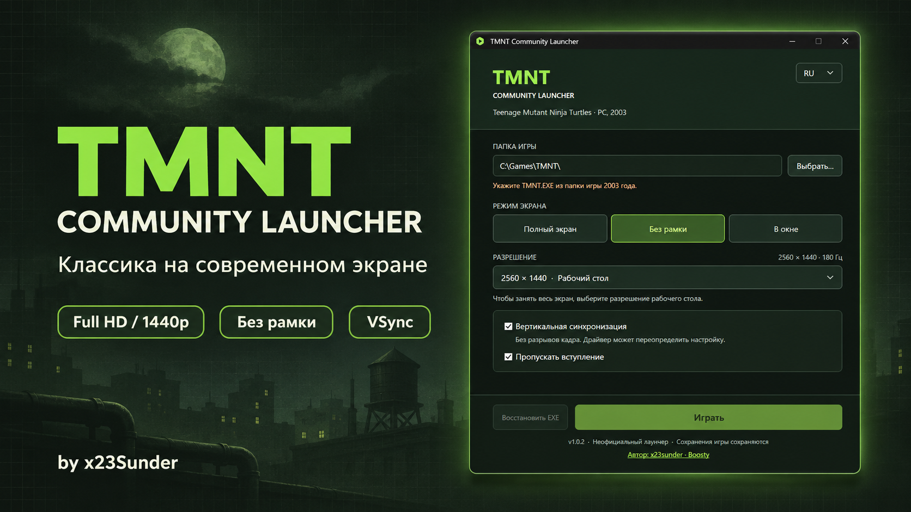
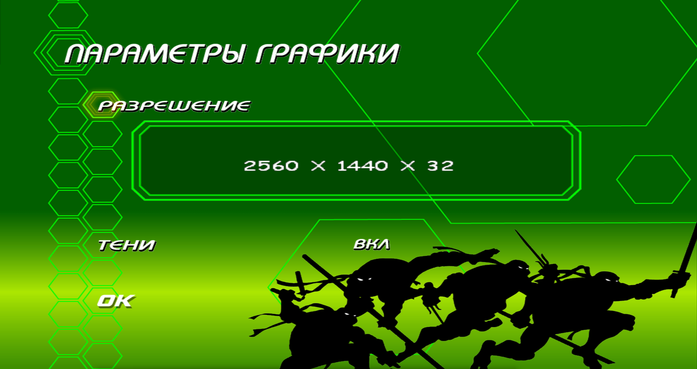

# TMNT 2003 Community Launcher

Классика на современном экране — неофициальный переносимый лаунчер для **Teenage Mutant Ninja Turtles (PC, 2003)**.

**Автор: [x23sunder · Retro Co-op](https://boosty.to/x23sunder/)** · [Пост на Boosty](https://boosty.to/x23sunder/posts/421b1a31-7f13-4a03-9dac-00ac9b5226d8) · [English](README.en.md)

## Скачать

**[Скачать TMNT Launcher 1.0.3](https://github.com/hallejuah/tmnt-2003-launcher-releases/releases/latest/download/TMNTLauncher_v1.0.3.zip)** · [Все релизы](https://github.com/hallejuah/tmnt-2003-launcher-releases/releases)

Для запуска нужен `TMNTLauncher.exe` и установленная совместимая версия игры. Исходный код здесь не публикуется.

## Возможности

- Современные разрешения, включая Full HD и 2560×1440.
- Полноэкранный режим, окно без рамки и обычное окно.
- Включение и выключение вертикальной синхронизации — VSync.
- Пропуск логотипов и вступительного ролика до экрана «Жми Старт».
- Русский и английский интерфейс с переключателем RU / EN.
- Проверка совместимости, сохранение настроек, резервные копии и восстановление EXE.

## Как пользоваться

1. Распакуйте архив и положите **TMNTLauncher.exe** рядом с **TMNT.EXE** в папке игры.
2. Откройте лаунчер. Если игра не обнаружилась автоматически, нажмите **«Выбрать…»** и укажите TMNT.EXE.
3. Выберите разрешение, режим экрана, VSync и пропуск вступления.
4. Нажмите **«Играть»**. Выбранные параметры сохранятся.

Для окна без рамки на весь монитор выберите разрешение с пометкой **«Рабочий стол»**. Если доступен только **«Первый запуск»**, запустите игру этой кнопкой, сохраните настройки в самой игре и закройте её. Затем вернитесь в лаунчер.

Вернуть исходный EXE можно кнопкой **«Восстановить EXE»**. Резервные копии находятся в **TMNTLauncherData** — сохраните эту папку для восстановления.

## Совместимость

Нужны **Windows 10/11**, **.NET Framework 4.8** и совместимая ПК-версия **TMNT 2003**. Проверена конкретная русская сборка игры; неизвестный EXE лаунчер не изменяет. Другие издания и TMNT 2007 пока не поддерживаются. Подробности и SHA-256 — в [инструкции](INSTALL-RU.txt).

Для кооператива на двух компьютерах используйте отдельный **[TMNT 2003 LAN Co-op](https://github.com/hallejuah/tmnt-2003-lan-coop-releases)**.

## Поддержка и обратная связь

[Сообщить об ошибке](https://github.com/hallejuah/tmnt-2003-launcher-releases/issues/new) · **[Поддержать разработку на Boosty](https://boosty.to/x23sunder/)**

Укажите версию лаунчера, Windows и действия, после которых возникла проблема.

Описание и иллюстрации адаптированы из публикации автора на Boosty. Игра в комплект не входит. Это неофициальный проект; права на TMNT и игровые материалы принадлежат их владельцам. Лицензия лаунчера: [MIT](LICENSE.txt).
